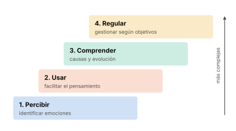

# Capítulo 1. Qué es la inteligencia emocional {#sec-cap1}

::: {.callout-note appearance="default"}
## Objetivos
- Definir la inteligencia emocional como capacidad y distinguirla de los modelos mixtos.
- Conocer las cuatro ramas del modelo de Mayer y Salovey.
- Valorar con espíritu crítico lo que la evidencia dice sobre su utilidad.
:::

::: {.callout-note appearance="simple" icon="false"}
## Glosario del capítulo
[Inteligencia emocional](92-glosario.qmd#gl-ie) · [Modelo de capacidad](92-glosario.qmd#gl-capacidad) · [Modelos mixtos](92-glosario.qmd#gl-mixtos) · [MSCEIT](92-glosario.qmd#gl-msceit) · [Validez incremental](92-glosario.qmd#gl-incremental) · [Modelo en cascada](92-glosario.qmd#gl-cascada)
:::

::: {.callout-tip appearance="simple" icon="false"}
## Descargas
[Plantilla de entrega del reto (.qmd)](plantillas/entrega_reto.qmd){.btn .btn-outline-primary .btn-sm download="entrega_reto.qmd"}
[Tema de estilo (.scss)](plantillas/informe.scss){.btn .btn-outline-primary .btn-sm download="informe.scss"}
:::

## Lectura obligatoria

::: {.lectura}
Mayer, J. D.; Salovey, P.; Caruso, D. R. (2008). [Emotional intelligence: New ability or eclectic traits?](https://doi.org/10.1037/0003-066X.63.6.503) *American Psychologist*, 63(6), 503-517.
:::

### Lectura complementaria {.unnumbered}

- Joseph, D. L.; Newman, D. A. (2010). [Emotional intelligence: An integrative meta-analysis and cascading model](https://doi.org/10.1037/a0017286). *Journal of Applied Psychology*, 95(1), 54-78.

## 1. Una capacidad, no un rasgo de personalidad

El término se popularizó en los años noventa y pronto se usó para casi todo: optimismo, motivación, habilidades sociales, liderazgo… Mayer, Salovey y Caruso (2008) defienden una definición más estricta: la **inteligencia emocional** es la **capacidad** de razonar con precisión sobre las emociones y de usar las emociones y el conocimiento emocional para mejorar el pensamiento.

Distinguen dos familias de enfoques:

- **Modelo de capacidad**: la inteligencia emocional es un conjunto de capacidades mentales, medibles con tareas que tienen respuestas mejores y peores, como un test de inteligencia (por ejemplo, el **MSCEIT**).
- **Modelos mixtos**: combinan capacidades con rasgos de personalidad, motivación y competencias diversas, y se miden con cuestionarios de autoinforme. Critican que mezclan cosas distintas y que se solapan mucho con la personalidad ya conocida.

## 2. Las cuatro ramas

| Rama | Capacidad | En la vida investigadora |
|---|---|---|
| **1. Percibir** | Identificar emociones en uno mismo, en otras personas y en expresiones | Notar que un compañero está desbordado antes de que lo diga |
| **2. Usar** | Aprovechar las emociones para facilitar el pensamiento | Revisar errores cuando estás de humor crítico; generar ideas cuando estás animado |
| **3. Comprender** | Entender el vocabulario emocional, las causas y la evolución de las emociones | Saber que la frustración puede convertirse en desánimo si se acumula |
| **4. Regular** | Gestionar las emociones propias y ajenas según los objetivos | Recuperarte de una revisión dura y responder con calma |

{#fig-i1-ramas fig-alt="Cuatro bloques escalonados de abajo arriba: percibir, usar, comprender y regular las emociones. Una flecha indica que las capacidades superiores se apoyan en las inferiores."}

## 3. Qué dice la evidencia

Joseph y Newman (2010) integraron decenas de estudios en un metaanálisis y propusieron un **modelo en cascada**: la percepción de las emociones favorece su comprensión, esta su regulación, y la regulación se asocia con el rendimiento laboral, sobre todo en trabajos con alta carga emocional (atender a personas, gestionar conflictos). También mostraron que los cuestionarios de los modelos mixtos predicen el rendimiento en parte porque se solapan con la personalidad y la autoeficacia; su **validez incremental** (lo que añaden más allá de lo ya conocido) es discutida.

Conclusiones prudentes:

- La inteligencia emocional **existe** y es distinta de la inteligencia general y de la personalidad, pero **no es una varita mágica**: los efectos son moderados.
- Muchas afirmaciones populares (que explica la mayor parte del éxito profesional, por ejemplo) **no tienen apoyo empírico**.
- Las capacidades emocionales **se pueden mejorar** con práctica, sobre todo la comprensión y la regulación.

## Caso práctico resuelto

::: {.callout-note appearance="simple" icon="false"}
## Las cuatro ramas en una reunión difícil
Situación: en la reunión del grupo, tu director critica con dureza un capítulo.

- **Percibir:** notas tensión en tu cuerpo y que tu compañera mira al suelo; tu director parece cansado.
- **Usar:** decides no responder en ese momento, porque con enfado te cuesta pensar con claridad.
- **Comprender:** lo que sientes es frustración (habías trabajado mucho) y algo de vergüenza (fue en público); sabes que, si no la gestionas, puede convertirse en desmotivación.
- **Regular:** pides una reunión al día siguiente para entender los comentarios y, mientras, sales a caminar.

El análisis no elimina la emoción, pero te ayuda a elegir qué hacer con ella.
:::

## Ejercicios graduados

**Básico.** ¿Qué rama se pone en juego al notar que una compañera está agobiada antes de que lo diga?

::: {.webex-solution boton="Ver solución"}
Percibir las emociones de otras personas.
:::

**Avanzado.** Analiza con las cuatro ramas una situación reciente de tu trabajo (puedes cambiar los detalles).

::: {.webex-solution boton="Ver solución"}
Describe qué percibiste, cómo influyó la emoción en tu pensamiento, qué comprendiste de ella y qué hiciste para regularla, y qué harías distinto.
:::

## Actividades

::: {.clasificar #ia-i1-rama titulo="¿Qué rama del modelo de Mayer y Salovey?" categorias="Percibir|Usar|Comprender|Regular"}
- Notar por el tono de un correo que la editora está molesta → Percibir
- Dejar la revisión de un texto para cuando estés en un estado de ánimo más crítico → Usar
- Saber que la decepción por un rechazo puede convertirse en enfado → Comprender
- Respirar y esperar un día antes de responder a una crítica injusta → Regular
- Identificar que lo que sientes antes de la defensa es miedo y no entusiasmo → Percibir
:::

::: {.clasificar #ia-i1-mito titulo="¿Apoyado por la evidencia o mito?" categorias="Apoyado por la evidencia|Mito o exageración"}
- La inteligencia emocional explica la mayor parte del éxito profesional → Mito o exageración
- Las capacidades emocionales se pueden mejorar con práctica → Apoyado por la evidencia
- La inteligencia emocional se asocia con el rendimiento, sobre todo en trabajos con carga emocional → Apoyado por la evidencia
- Los cuestionarios de autoinforme miden lo mismo que las pruebas de capacidad → Mito o exageración // Se solapan más con la personalidad.
:::

## Reto evaluable {#reto-i1}

::: {.callout-important appearance="simple" icon="false"}
## Reto del capítulo 1 · Las cuatro ramas en tu trabajo
1. Describe una situación reciente de tu trabajo con una carga emocional importante (puedes cambiar los detalles para preservar la intimidad).
2. Analízala con las **cuatro ramas**: qué percibiste, cómo influyeron las emociones en tu pensamiento, qué comprendiste y cómo las regulaste.
3. Busca un artículo de divulgación sobre inteligencia emocional y evalúa sus afirmaciones con lo aprendido en este capítulo.

**Entrega:** con la [plantilla de entrega](plantillas/entrega_reto.qmd). Este reto **no tiene solución en el libro**.
:::

## Autoevaluación

Responde a todas las preguntas y pulsa **Mostrar respuestas**. No cuenta para la nota.

::: {.webex-check .webex-box}
1. Para Mayer, Salovey y Caruso (2008), la inteligencia emocional es sobre todo 
2. Los modelos que combinan capacidades con rasgos de personalidad se llaman modelos 
3. La rama más compleja del modelo de capacidad es 
4. El MSCEIT es un cuestionario de autoinforme. 
5. Joseph y Newman (2010) proponen un modelo en 
6. Según la evidencia, la inteligencia emocional explica la mayor parte del éxito profesional. 
7. Lo que un predictor añade más allá de otros ya conocidos es su validez 
8. ¿En qué trabajos se asocia más la inteligencia emocional con el rendimiento?


:::

::: {.webex-solution boton="Ver explicaciones"}
- Modelo de capacidad.
- Goleman, Bar-On.
- Regular se apoya en las otras tres.
- Es una prueba de capacidad con tareas.
- Percibir → comprender → regular → rendimiento.
- Efectos moderados.
- *Incremental validity*.
- Joseph y Newman (2010).
:::
