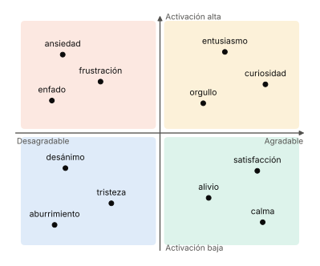

# Capítulo 2. Reconocer y comprender las emociones {#sec-cap2}

::: {.callout-note appearance="default"}
## Objetivos
- Entender qué son las emociones y qué funciones cumplen.
- Ampliar el vocabulario emocional para distinguir emociones parecidas.
- Reconocer las emociones típicas del ciclo de la investigación.
:::

::: {.callout-note appearance="simple" icon="false"}
## Glosario del capítulo
[Emoción](92-glosario.qmd#gl-emocion) · [Estado de ánimo](92-glosario.qmd#gl-animo) · [Valencia y activación](92-glosario.qmd#gl-valencia) · [Granularidad emocional](92-glosario.qmd#gl-granularidad) · [Etiquetado afectivo](92-glosario.qmd#gl-etiquetado)
:::

::: {.callout-tip appearance="simple" icon="false"}
## Descargas
[Plantilla de entrega del reto (.qmd)](plantillas/entrega_reto.qmd){.btn .btn-outline-primary .btn-sm download="entrega_reto.qmd"}
[Tema de estilo (.scss)](plantillas/informe.scss){.btn .btn-outline-primary .btn-sm download="informe.scss"}
:::

## Lectura obligatoria

::: {.lectura}
Kashdan, T. B.; Barrett, L. F.; McKnight, P. E. (2015). [Unpacking emotion differentiation: Transforming unpleasant experience by perceiving distinctions in negativity](https://doi.org/10.1177/0963721414550708). *Current Directions in Psychological Science*, 24(1), 10-16.
:::

## 1. Qué son y para qué sirven

Una **emoción** es una respuesta breve a algo que nos importa: combina una valoración de la situación, cambios fisiológicos, una tendencia a actuar y una experiencia subjetiva. Un **estado de ánimo** es más difuso y duradero y no suele tener un desencadenante claro.

Las emociones no son un obstáculo para el pensamiento: **informan** (algo importa), **preparan** para actuar y **comunican** a los demás. El miedo antes de una defensa señala que te importa y moviliza recursos; la frustración indica que algo bloquea un objetivo. El problema no es sentir, sino interpretar mal o reaccionar sin pensar.

Una forma útil de situarlas es con dos dimensiones: la **valencia** (agradable-desagradable) y la **activación** (calma-agitación).

{#fig-i2-circ fig-alt="Plano con la valencia en el eje horizontal y la activación en el vertical. Arriba a la izquierda: ansiedad, frustración, enfado. Arriba a la derecha: entusiasmo, curiosidad, orgullo. Abajo a la izquierda: desánimo, tristeza, aburrimiento. Abajo a la derecha: calma, satisfacción, alivio."}

## 2. Ponerles nombre con precisión

Kashdan, Barrett y McKnight (2015) revisan la investigación sobre la **granularidad emocional** (o diferenciación emocional): la capacidad de distinguir con precisión entre emociones parecidas («estoy decepcionado» frente a «estoy avergonzado» frente a «estoy irritado», en lugar de «estoy mal»). Las personas con más granularidad para las emociones desagradables tienden a regularlas mejor y a recurrir menos a estrategias perjudiciales cuando están bajo presión.

Nombrar lo que sientes (**etiquetado afectivo**) ya tiene un efecto regulador, y la precisión permite elegir mejor qué hacer: la decepción pide revisar expectativas; la vergüenza, separar el error de la identidad; la irritación, quizá poner un límite.

## 3. El ciclo emocional de la investigación

| Fase | Emociones frecuentes |
|---|---|
| Idea nueva | Entusiasmo, curiosidad, a veces euforia |
| Trabajo largo sin resultados | Frustración, aburrimiento, duda |
| Envío a una revista o convocatoria | Ansiedad, esperanza |
| Rechazo o revisión dura | Decepción, enfado, vergüenza |
| Resultado o publicación | Alivio, orgullo, a veces vacío |
| Defensa y transiciones | Miedo, incertidumbre, nostalgia |

Saber que son normales no las elimina, pero ayuda a no interpretarlas como señales de incapacidad.

## Laboratorio: amplía tu vocabulario emocional {#lab-i2-vocab}

::: {.laboratorio}
::: {.laboratorio-etiqueta}
Laboratorio · se ejecuta en tu navegador
:::

Elige la familia de lo que sientes y su intensidad. El laboratorio te propone palabras más precisas y una pregunta para afinar.

```{ojs}
//| echo: false
seleccion = window.Lab.seleccion
rango = window.Lab.rango
viewof familia = seleccion("Familia de la emoción", ["Miedo", "Enfado", "Tristeza", "Vergüenza", "Alegría", "Interés"], {value: "Miedo"})
viewof intensidad = rango("Intensidad", [1, 3], {value: 2, formato: x => ["baja", "media", "alta"][x - 1]})
```

```{ojs}
//| echo: false
{
  const V = {
    "Miedo": [["inquietud", "preocupación", "incertidumbre"], ["ansiedad", "nerviosismo", "aprensión"], ["pánico", "angustia", "terror"], "¿Qué es lo que temes que ocurra, en concreto?"],
    "Enfado": [["fastidio", "impaciencia", "molestia"], ["irritación", "frustración", "indignación"], ["rabia", "ira", "furia"], "¿Qué objetivo o qué valor sientes que se ha bloqueado o vulnerado?"],
    "Tristeza": [["melancolía", "desánimo", "nostalgia"], ["decepción", "pena", "desaliento"], ["desesperanza", "abatimiento", "desolación"], "¿Qué has perdido o qué esperabas que no ha ocurrido?"],
    "Vergüenza": [["incomodidad", "timidez", "apuro"], ["bochorno", "culpa", "inseguridad"], ["humillación", "sentirse fuera de lugar", "indignidad"], "¿Es por algo que hiciste (culpa) o por cómo te ves (vergüenza)?"],
    "Alegría": [["satisfacción", "tranquilidad", "agrado"], ["entusiasmo", "orgullo", "gratitud"], ["euforia", "júbilo", "exaltación"], "¿Qué ha salido bien y qué papel has tenido tú?"],
    "Interés": [["curiosidad", "atención", "intriga"], ["motivación", "implicación", "fascinación"], ["absorción", "pasión", "flujo"], "¿Qué te gustaría descubrir ahora?"]
  };
  const [b, m, a, q] = V[familia], pal = [b, m, a][intensidad - 1];
  const d = html`<div role="status"></div>`;
  d.innerHTML = `<p>Palabras más precisas para <strong>${familia.toLowerCase()}</strong> de intensidad ${["baja", "media", "alta"][intensidad - 1]}:</p>
   <p style="font-size:1.25rem">${pal.map(w => `<span class="badge text-bg-light border me-1">${w}</span>`).join("")}</p>
   <p><strong>Para afinar:</strong> ${q}</p>
   <p class="small">Prueba a completar: «Siento ___ porque ___, y lo que necesito es ___».${intensidad === 3 && ["Miedo", "Tristeza", "Vergüenza"].includes(familia) ? ' Si sientes esto con intensidad alta durante días, habla con alguien de confianza o con un profesional (ver <a href="90-recursos.html">Recursos de apoyo</a>).' : ""}</p>`;
  return d;
}
```
:::

## Caso práctico resuelto

::: {.callout-note appearance="simple" icon="false"}
## De «estoy mal» a una emoción con nombre
Después de una evaluación de seguimiento negativa, una doctoranda escribe en su diario: «Estoy fatal». Con el laboratorio del capítulo afina:

1. **Familia:** tristeza y vergüenza.
2. **Precisión:** «decepcionada» (esperaba otra valoración) y «avergonzada» (le preocupa lo que piense el tribunal).
3. **Necesidad:** entender qué falta en el plan y separar el resultado de su valía.
4. **Acción:** pedir los comentarios por escrito y reunirse con su directora.

Ponerle nombre preciso convierte un malestar difuso en algo con lo que se puede trabajar.
:::

## Segundo caso práctico resuelto

::: {.callout-note appearance="simple" icon="false"}
## Un diario emocional de una semana
Un doctorando que «siempre está agobiado» lleva durante una semana un registro breve: momento, situación, emoción con nombre preciso, intensidad (0-10) y qué hizo después.

| Día | Situación | Emoción | Int. | Qué hizo |
|---|---|---|---|---|
| Lunes | Reunión con su director | Inseguridad | 6 | Calló sus dudas sobre el análisis |
| Martes | El código falla otra vez | Frustración | 7 | Siguió tres horas sin pausa |
| Miércoles | Un compañero publica | Envidia, luego desánimo | 5 | Dejó de escribir esa tarde |
| Jueves | El análisis por fin funciona | Alivio, satisfacción | 6 | Lo contó en el grupo |
| Viernes | Plazo de un congreso | Ansiedad | 8 | Trabajó hasta tarde |

Al revisar la tabla, «agobio» se descompone en emociones distintas con causas distintas: la inseguridad aparece con su director; la frustración, con el código. Cada una pide una respuesta diferente: preparar las dudas por escrito antes de las reuniones; poner un límite de una hora antes de pedir ayuda con el código.
:::

```{dot}
//| label: fig-i2-diario
//| fig-cap: "De una etiqueta vaga a emociones con nombre y respuestas específicas."
//| fig-alt: "Una caja con la palabra agobio se divide en inseguridad, frustración y ansiedad, y cada una lleva a una respuesta distinta."
digraph {
  bgcolor="white"; pad=0.2; rankdir=LR;
  node [shape=box, style="rounded,filled", fillcolor="#eef3fb", color="#1a4d8f", fontname="Helvetica", fontsize=11];
  edge [color="#45433f", fontname="Helvetica", fontsize=10];
  g [label="«Agobio»", fillcolor="#fdf0e8"];
  i [label="Inseguridad"]; f [label="Frustración"]; a [label="Ansiedad"];
  ri [label="Llevar las dudas\npor escrito", fillcolor="#eaf6ef"]; rf [label="Pedir ayuda\ntras una hora", fillcolor="#eaf6ef"]; ra [label="Planificar el plazo\ncon antelación", fillcolor="#eaf6ef"];
  g -> i -> ri; g -> f -> rf; g -> a -> ra;
}
```

## Ejercicios graduados

**Básico.** Sustituye «estoy mal» por una emoción más precisa en esta situación: el código que llevas días depurando sigue fallando.

::: {.webex-solution boton="Ver solución"}
Por ejemplo, «frustrado» (algo bloquea tu objetivo) o «desanimado» si dura días; cada una sugiere una respuesta distinta (cambiar de estrategia, pedir ayuda, descansar).
:::

**Avanzado.** Lleva un diario emocional de una semana y analiza cuántas emociones distintas has nombrado.

::: {.webex-solution boton="Ver solución"}
La reflexión debe valorar si el vocabulario se amplía con la práctica y si nombrar con precisión cambia lo que haces.
:::


## Actividades

::: {.clasificar #ia-i2-cuadrante titulo="¿Dónde está cada emoción? (valencia y activación)" categorias="Desagradable y activada|Desagradable y calmada|Agradable y activada|Agradable y calmada"}
- Ansiedad antes de la defensa → Desagradable y activada
- Desánimo tras meses sin resultados → Desagradable y calmada
- Entusiasmo por una idea nueva → Agradable y activada
- Alivio al enviar la tesis → Agradable y calmada
- Frustración porque el código falla → Desagradable y activada
- Aburrimiento durante la limpieza de datos → Desagradable y calmada
:::

::: {.clasificar #ia-i2-culpa titulo="¿Culpa o vergüenza?" categorias="Culpa|Vergüenza"}
- «Hice mal el análisis y tengo que corregirlo» → Culpa // Se centra en la conducta: lleva a reparar.
- «Soy un fraude, no valgo para esto» → Vergüenza // Se centra en la identidad: lleva a esconderse.
- «Debería haber avisado antes a mi coautora del retraso» → Culpa
- «Todos se darán cuenta de que no estoy a la altura» → Vergüenza
:::

## Reto evaluable {#reto-i2}

::: {.callout-important appearance="simple" icon="false"}
## Reto del capítulo 2 · Diario emocional de dos semanas
1. Durante dos semanas, anota una vez al día la emoción más intensa relacionada con tu trabajo: nombre **preciso**, intensidad (1-10), desencadenante y qué hiciste.
2. Al final, analiza tu diario: ¿qué emociones se repiten?, ¿en qué fases del trabajo?, ¿ha cambiado tu vocabulario?
3. Escribe una reflexión sobre lo aprendido. No es necesario entregar el diario completo: basta con el análisis.

**Entrega:** con la [plantilla de entrega](plantillas/entrega_reto.qmd). Este reto **no tiene solución en el libro**.
:::

## Autoevaluación

Responde a todas las preguntas y pulsa **Mostrar respuestas**. No cuenta para la nota.

::: {.webex-check .webex-box}
1. Un estado de ánimo es más breve y tiene un desencadenante más claro que una emoción. 
2. Las dos dimensiones básicas para situar las emociones son la valencia y la 
3. La capacidad de distinguir con precisión entre emociones parecidas es la granularidad 
4. Según @kashdan2015, más granularidad para las emociones desagradables se asocia con 
5. Nombrar una emoción ya puede tener un efecto regulador. 
6. «Soy un fraude» expresa sobre todo 
7. Las emociones son siempre un obstáculo para pensar con claridad. 
8. ¿Qué funciones cumplen las emociones?


:::

::: {.webex-solution boton="Ver explicaciones"}
- Al revés.
- *Valence and arousal*.
- *Emotion differentiation*.
- Y menos estrategias perjudiciales.
- Etiquetado afectivo.
- Se centra en la identidad.
- Informan y preparan.
- Tres funciones.
:::
