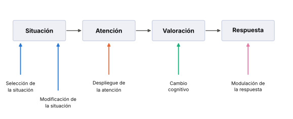

# Capítulo 3. Regular las emociones {#sec-cap3}

::: {.callout-note appearance="default"}
## Objetivos
- Conocer el modelo de proceso de la regulación emocional y sus cinco familias de estrategias.
- Distinguir estrategias con efectos más favorables (reevaluación) y menos (supresión).
- Preparar planes «si-entonces» para situaciones difíciles previsibles.
:::

::: {.callout-note appearance="simple" icon="false"}
## Glosario del capítulo
[Regulación emocional](92-glosario.qmd#gl-regulacion) · [Modelo de proceso](92-glosario.qmd#gl-proceso) · [Reevaluación cognitiva](92-glosario.qmd#gl-reevaluacion) · [Supresión expresiva](92-glosario.qmd#gl-supresion) · [Rumiación](92-glosario.qmd#gl-rumiacion) · [Intención de implementación](92-glosario.qmd#gl-implementacion)
:::

::: {.callout-tip appearance="simple" icon="false"}
## Descargas
[Plantilla de entrega del reto (.qmd)](plantillas/entrega_reto.qmd){.btn .btn-outline-primary .btn-sm download="entrega_reto.qmd"}
[Tema de estilo (.scss)](plantillas/informe.scss){.btn .btn-outline-primary .btn-sm download="informe.scss"}
:::

## Lectura obligatoria

::: {.lectura}
Gross, J. J. (1998). [The emerging field of emotion regulation: An integrative review](https://doi.org/10.1037/1089-2680.2.3.271). *Review of General Psychology*, 2(3), 271-299.
:::

### Lectura complementaria {.unnumbered}

- @gollwitzer1999

## 1. El modelo de proceso

La **regulación emocional** es el conjunto de procesos con los que influimos en qué emociones tenemos, cuándo y cómo las vivimos y expresamos. @gross1998 la ordena según el momento en que se interviene en la generación de una emoción, lo que da cinco familias de estrategias:

| Momento | Familia | Ejemplo |
|---|---|---|
| Antes de la situación | **Selección de la situación** | No leer las evaluaciones de la revista a las once de la noche |
| | **Modificación de la situación** | Pedir que la reunión difícil tenga un orden del día |
| Durante la situación | **Despliegue de la atención** | Centrarse en los comentarios útiles de la revisión, no en el tono |
| | **Cambio cognitivo** (reevaluación) | «El rechazo es sobre este manuscrito, no sobre mi valía; los informes me dicen cómo mejorarlo» |
| Después de que surge la emoción | **Modulación de la respuesta** | Respirar despacio, hacer ejercicio; o suprimir la expresión |

{#fig-i3-proceso fig-alt="Secuencia de izquierda a derecha: situación, atención, valoración y respuesta. Debajo, cinco flechas señalan dónde actúa cada familia: selección y modificación de la situación, despliegue de la atención, cambio cognitivo y modulación de la respuesta."}

## 2. No todas las estrategias son iguales

Gross contrasta dos estrategias muy estudiadas:

- La **reevaluación cognitiva** (cambiar la interpretación de la situación) actúa pronto y tiende a reducir la experiencia emocional desagradable sin grandes costes.
- La **supresión expresiva** (ocultar lo que se siente) actúa tarde: reduce la expresión, pero no tanto la experiencia, y tiene costes fisiológicos, de memoria y sociales.

Otras estrategias habituales: la **rumiación** (dar vueltas una y otra vez a lo que salió mal) suele prolongar el malestar; la **aceptación** (permitir la emoción sin luchar contra ella) y la **resolución de problemas** suelen ayudar. Ninguna estrategia es buena en todas las situaciones: la **flexibilidad** para elegir según el contexto es lo que más se asocia con el bienestar.

## 3. Planes «si-entonces»

@gollwitzer1999 mostró que las **intenciones de implementación**, planes con la forma «*si* ocurre la situación X, *entonces* haré Y», aumentan mucho la probabilidad de actuar como queremos, porque la situación dispara la conducta casi automáticamente. Son especialmente útiles para situaciones emocionales previsibles: la llegada de una revisión, una reunión tensa, el bloqueo ante la página en blanco.

## Laboratorio: tu plan si-entonces {#lab-i3-plan}

::: {.laboratorio}
::: {.laboratorio-etiqueta}
Laboratorio · se ejecuta en tu navegador; tu texto no sale de él
:::

```{ojs}
//| echo: false
texto = window.Lab.texto
seleccion = window.Lab.seleccion
viewof sit = texto("Si… (situación previsible)", {value: "recibo un correo con la decisión de la revista"})
viewof emo = texto("…y probablemente sienta…", {value: "ansiedad y miedo al rechazo"})
viewof estr = seleccion("Familia de estrategia", ["Selección de la situación", "Modificación de la situación", "Despliegue de la atención", "Cambio cognitivo (reevaluación)", "Modulación de la respuesta"], {value: "Selección de la situación"})
viewof acc = texto("…entonces haré…", {value: "leerlo por la mañana, con tiempo, y no responder hasta el día siguiente"})
```

```{ojs}
//| echo: false
{
  const esc = s => (s || "").replace(/&/g, "&amp;").replace(/</g, "&lt;");
  const consejo = {
    "Selección de la situación": "Útil cuando puedes elegir el momento o el contexto. Cuidado con convertirla en evitación sistemática.",
    "Modificación de la situación": "Cambia algo de la situación: pide un orden del día, una pausa, un acompañante.",
    "Despliegue de la atención": "Dirige la atención a lo útil o a lo que depende de ti. Distraerse un rato ayuda en emociones intensas.",
    "Cambio cognitivo (reevaluación)": "Prepara la frase alternativa por adelantado: con la emoción alta cuesta inventarla.",
    "Modulación de la respuesta": "Respiración lenta, movimiento, una pausa antes de responder. Evita suprimir sin más."
  }[estr];
  const vaga = (acc || "").trim().split(/\s+/).length < 4;
  const d = html`<div role="status"></div>`;
  d.innerHTML = `<blockquote style="font-size:1.1rem"><strong>Si</strong> ${esc(sit)} y siento ${esc(emo)}, <strong>entonces</strong> ${esc(acc)}.</blockquote>
   <p><strong>${estr}:</strong> ${consejo}</p>
   ${vaga ? '<p class="lab-medio" style="font-weight:600">La acción es muy breve o vaga: concreta qué harás, cuándo y dónde.</p>' : '<p class="lab-bien" style="font-weight:600">Plan concreto. Escríbelo donde lo veas en el momento en que lo necesitarás.</p>'}`;
  return d;
}
```
:::

## Caso práctico resuelto

::: {.callout-note appearance="simple" icon="false"}
## Tres planes si-entonces para la defensa de la tesis
1. **Si** la noche anterior no puedo dormir, **entonces** me levanto, leo algo ajeno a la tesis veinte minutos y vuelvo a la cama (modulación de la respuesta y despliegue de la atención).
2. **Si** el tribunal hace una pregunta que no sé responder, **entonces** respiro, reconozco el límite y explico cómo lo abordaría (cambio cognitivo: «no saberlo todo es normal y honesto»).
3. **Si** noto que me acelero al hablar, **entonces** hago una pausa al cambiar de diapositiva y miro a una persona concreta (modificación de la situación).

Los planes se escriben antes y se repasan el día de antes, para que la situación active la respuesta.
:::

## Segundo caso práctico resuelto

::: {.callout-note appearance="simple" icon="false"}
## Elegir el momento de regular
El modelo de proceso dice que se puede intervenir en cinco momentos. Una investigadora que se pone muy nerviosa antes de presentar en congresos prueba una estrategia en cada uno:

| Momento | Estrategia | Qué hizo | Resultado |
|---|---|---|---|
| Selección de la situación | Elegir el formato | Pidió presentar en la sesión de pósteres el primer año | Útil como paso intermedio, no como solución permanente |
| Modificación de la situación | Cambiar las condiciones | Ensayó en la sala la víspera | Muy útil: menos sorpresas |
| Despliegue de la atención | Dónde poner el foco | Mirar a dos caras amables del público | Útil |
| Cambio cognitivo | Reevaluar | «La activación me prepara para hacerlo bien» | Útil: misma activación, otra lectura |
| Modulación de la respuesta | Actuar sobre el cuerpo | Respiración lenta antes de subir | Útil a corto plazo |
| (Contraejemplo) | Suprimir | Intentar no mostrar nada | Más tensión y peor recuerdo de las preguntas |

Las estrategias tempranas (antes de que la emoción esté en marcha) y la reevaluación dieron mejores resultados que intentar ocultar la emoción una vez desatada.
:::

```{dot}
//| label: fig-i3-proceso
//| fig-cap: "El modelo de proceso: cinco momentos para regular una emoción."
//| fig-alt: "Secuencia de cinco momentos: selección de la situación, modificación de la situación, despliegue de la atención, cambio cognitivo y modulación de la respuesta, con una flecha que indica que intervenir antes suele ser más eficaz."
digraph {
  bgcolor="white"; pad=0.2; rankdir=LR;
  node [shape=box, style="rounded,filled", fillcolor="#eef3fb", color="#1a4d8f", fontname="Helvetica", fontsize=11];
  edge [color="#45433f", fontname="Helvetica", fontsize=10];
  s [label="Selección\nde la situación"]; m [label="Modificación\nde la situación"]; a [label="Despliegue\nde la atención"]; c [label="Cambio\ncognitivo", fillcolor="#eaf6ef"]; r [label="Modulación\nde la respuesta"];
  s -> m -> a -> c -> r;
}
```

## Ejercicios graduados

**Básico.** ¿Qué familia de estrategias de Gross es «ver la pregunta difícil del tribunal como una oportunidad»?

::: {.webex-solution boton="Ver solución"}
Cambio cognitivo (reevaluación).
:::

**Avanzado.** Escribe tres planes si-entonces para una situación difícil que tengas en las próximas semanas, con al menos dos familias de estrategias.

::: {.webex-solution boton="Ver solución"}
Deben ser concretos (situación precisa, acción observable) y basarse en estrategias con buen apoyo (reevaluación, aceptación, resolución de problemas) más que en la supresión.
:::


## Actividades

::: {.clasificar #ia-i3-familia titulo="¿Qué familia de estrategia? [@gross1998]" categorias="Selección de la situación|Modificación de la situación|Despliegue de la atención|Cambio cognitivo|Modulación de la respuesta"}
- No consultar el correo durante el fin de semana antes de la defensa → Selección de la situación
- Pedir que la reunión con el director sea por la mañana y con un orden del día → Modificación de la situación
- Durante la presentación, mirar a las personas que asienten → Despliegue de la atención
- Ver la pregunta difícil del tribunal como una oportunidad para lucirse → Cambio cognitivo
- Salir a caminar veinte minutos después de leer la revisión → Modulación de la respuesta
:::

::: {.escenario #ia-i3-rechazo titulo="El artículo rechazado"}
Son las once de la noche. Recibes el rechazo del artículo en el que llevas dos años, con un revisor muy duro.

### El correo {#i3e-inicio}
¿Qué haces?

- [Contestar ahora mismo al editor explicando que el revisor no ha entendido nada](#i3e-responder)
- [Cerrar el correo, reconocer que estás muy decepcionado y dejarlo para mañana](#i3e-pausa)

### Respuesta impulsiva {#i3e-responder .final .mal}
Actúas con la emoción en su punto álgido. El correo dañará tu relación con la revista y no cambiará la decisión.

### Pausa {#i3e-pausa}
Al día siguiente relees los informes. ¿Cómo los interpretas?

- [«Si me rechazan, es que no valgo para investigar»](#i3e-rumia)
- [«Dos comentarios son injustos, pero tres señalan problemas reales; corregirlos hará el artículo mejor para la siguiente revista»](#i3e-reevalua)

### Rumiación {#i3e-rumia .final .regular}
La interpretación generaliza un hecho concreto a tu identidad. Prolonga el malestar y no ayuda a mejorar el artículo.

### Reevaluación {#i3e-reevalua .final .bien}
Separas el resultado de tu valía, reconoces lo injusto y lo útil y conviertes la emoción en un plan. Es la estrategia con efectos más favorables según @gross1998.
:::

## Reto evaluable {#reto-i3}

::: {.callout-important appearance="simple" icon="false"}
## Reto del capítulo 3 · Tres planes para tres situaciones
1. Identifica tres situaciones emocionalmente difíciles y previsibles de tu trabajo en los próximos meses.
2. Para cada una, escribe un plan **si-entonces** con el laboratorio, usando al menos dos familias de estrategias distintas.
3. Aplica al menos uno y escribe una reflexión: ¿qué funcionó?, ¿qué cambiarías?

**Entrega:** con la [plantilla de entrega](plantillas/entrega_reto.qmd). Este reto **no tiene solución en el libro**.
:::

## Autoevaluación

Responde a todas las preguntas y pulsa **Mostrar respuestas**. No cuenta para la nota.

::: {.webex-check .webex-box}
1. El modelo de proceso de @gross1998 tiene  familias de estrategias
2. Cambiar la interpretación de una situación es la reevaluación 
3. La supresión expresiva elimina la experiencia emocional sin costes. 
4. Dar vueltas una y otra vez a lo que salió mal es la 
5. Elegir no leer una evaluación de madrugada es 
6. Hay una estrategia de regulación que es la mejor en todas las situaciones. 
7. Un plan con la forma «si X, entonces Y» es una intención de 
8. ¿Por qué conviene preparar la reevaluación por adelantado?


:::

::: {.webex-solution boton="Ver explicaciones"}
- Situación (2), atención, cambio cognitivo, respuesta.
- *Cognitive reappraisal*.
- Reduce sobre todo la expresión, con costes.
- Prolonga el malestar.
- Actúa antes de la situación.
- La flexibilidad importa.
- @gollwitzer1999.
- Por eso los planes si-entonces ayudan.
:::
